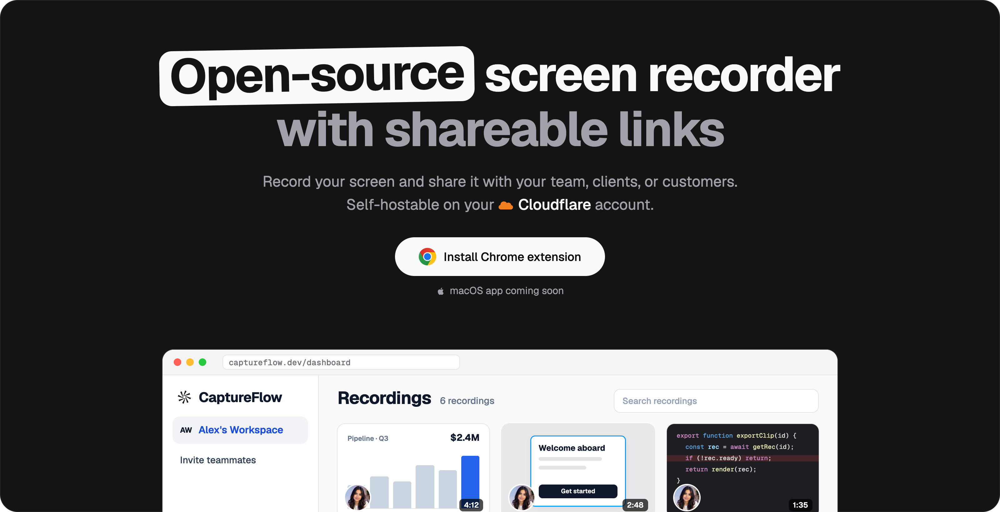

<div align="center"><a name="readme-top"></a>

<picture>
  <source media="(prefers-color-scheme: dark)" srcset="apps/web/public/brand-mark-light.svg" />
  
</picture>

<h1>CaptureFlow</h1>

Open-source screen recorder with instant share links, self-hostable on your own Cloudflare account.

[![CI status][ci-image]][ci-url] [![License: AGPL-3.0][license-image]][license-url] [![Chrome Web Store][chrome-image]][chrome-url] [![Stars][stars-image]][stars-url] [![Discord][discord-image]][discord-url]

[Website][website-url] · [Docs][docs-url] · [Blog][blog-url] · [Report Bug][issues-url] · [Request Feature][feature-url]

[ci-image]: https://github.com/sardorml/captureflow/actions/workflows/ci.yml/badge.svg
[ci-url]: https://github.com/sardorml/captureflow/actions/workflows/ci.yml
[license-image]: https://img.shields.io/badge/license-AGPL--3.0-2563EB.svg?style=flat-square
[license-url]: ./LICENSE
[chrome-image]: https://img.shields.io/chrome-web-store/v/lgpgeoelaokbigdljofhkgbfnfcnmcol?label=chrome%20web%20store&color=2563EB&style=flat-square
[chrome-url]: https://chromewebstore.google.com/detail/lgpgeoelaokbigdljofhkgbfnfcnmcol
[stars-image]: https://img.shields.io/github/stars/sardorml/captureflow?color=2563EB&style=flat-square
[stars-url]: https://github.com/sardorml/captureflow/stargazers
[discord-image]: https://img.shields.io/badge/chat-discord-5865F2.svg?style=flat-square
[discord-url]: https://discord.gg/qzeBCaEeNq
[website-url]: https://captureflow.dev
[docs-url]: https://docs.captureflow.dev
[blog-url]: https://captureflow.dev/blog
[issues-url]: https://github.com/sardorml/captureflow/issues/new
[feature-url]: https://captureflow.dev/suggest-feature

</div>

[](https://captureflow.dev)

## ✨ Features

- 🔗 The share link is ready the moment you stop: the upload runs while you record.
- 🎥 Record a tab, a window or your whole screen, with camera bubble and mic.
- 💬 Viewers react with emoji and comment right on the video, and you see who watched.
- 🖼 Annotated screenshots with arrows, text and blur, shared by the same kind of link.
- 👥 Workspaces for your team, with public, workspace-only or private visibility.
- 💸 Priced by storage for the whole team, never per seat.
- ☁️ Self-host on your own Cloudflare account, with sign-in limited to your company.
- 🔓 Every feature ships in the open-source build.

## 🖥 Where it runs

| Surface                   | Status                                          |
| ------------------------- | ----------------------------------------------- |
| Chrome extension          | Available on the [Chrome Web Store][chrome-url] |
| macOS app                 | Build from source; signed release coming soon   |
| Web dashboard and viewers | Any modern browser                              |

## 📦 Get started

- **Hosted:** [create a free account](https://captureflow.dev/login?mode=signup) and install the [Chrome extension][chrome-url]. Paid plans add 100 GB, 500 GB or 1 TB for the whole team; see [pricing](https://captureflow.dev/pricing).
- **Self-hosted:** run the whole thing on your own Cloudflare account (Workers, D1 and R2). Follow the [step-by-step guide](https://captureflow.dev/blog/self-hosted-screen-recorder), or [let us set it up for you](https://captureflow.dev/self-host-setup).

## ☁️ Self-hosting

[](https://deploy.workers.cloudflare.com/?url=https://github.com/sardorml/captureflow)

Or manually:

```bash
pnpm --filter @captureflow/web exec wrangler d1 create captureflow
pnpm --filter @captureflow/web exec wrangler r2 bucket create captureflow-recordings
# paste the database id into apps/web/wrangler.jsonc, then:
pnpm --filter @captureflow/web db:apply:remote
pnpm --filter @captureflow/web cf:deploy
```

[`DEPLOY.md`](./DEPLOY.md) is the full runbook: secrets, sign-in providers, custom domains, and pointing the extension and desktop app at your own instance. To run it as a private company tool, set `SELF_HOSTED` and `ALLOWED_EMAIL_DOMAINS` as described in the [configuration docs](https://docs.captureflow.dev/self-hosting/configuration).

## ⌨️ Development

Requires Node.js 24.13 or newer and pnpm 10 (`corepack enable`).

```bash
git clone git@github.com:sardorml/captureflow.git
cd captureflow
pnpm install
pnpm web                                  # dashboard and landing on http://localhost:3032
pnpm extension                            # browser extension, in a fresh Chrome profile
pnpm --filter @captureflow/desktop dev    # macOS recorder
```

Checks:

```bash
pnpm typecheck
pnpm --filter @captureflow/web test
pnpm --filter @captureflow/extension test
pnpm format
```

<details>
<summary>Monorepo layout</summary>

```
apps/
  web/         Next.js 16 landing, blog, dashboard, viewers and API → Cloudflare Workers (OpenNext)
  admin/       Instance-admin Worker on its own host, bound to the same D1 and R2
  extension/   Browser recorder (WXT, MV3): panel, offscreen capture, in-page controls
  desktop/     Electron screen recorder (macOS)
  docs/        VitePress documentation site
packages/
  engine/      Capture engine shared by desktop and extension: macOS sidecars, record protocol, mux (MIT)
  admin/       Admin auth and data logic behind apps/admin
  quota/       Storage quota, limits and workspace logic
  shared/      Types and constants shared across the apps
  ui/          Theme tokens and the React components with no HeroUI equivalent
```

Apps depend on packages, never the reverse, and never on each other.

The macOS capture sidecars are committed as built binaries. After editing the Swift sources, rebuild them with `packages/engine/scripts/build-native.sh` (add `--universal` for arm64 + x86_64).

</details>

## 🔗 Links

- [Website](https://captureflow.dev)
- [Documentation](https://docs.captureflow.dev)
- [Self-hosting docs](https://docs.captureflow.dev/self-hosting/overview)
- [Blog](https://captureflow.dev/blog)
- [Pricing](https://captureflow.dev/pricing)
- [FAQ](https://captureflow.dev/faq)
- [Security](https://captureflow.dev/security)
- [Releases](https://github.com/sardorml/captureflow/releases)
- [Discord][discord-url]

## 🤝 Contributing [](https://github.com/sardorml/captureflow/pulls)

Bug reports, ideas and pull requests are all welcome. Open an [issue][issues-url], [suggest a feature][feature-url], or send a pull request. Read [`CONVENTIONS.md`](./CONVENTIONS.md) first: it's the standard every change follows.

Found a security issue? Please report it privately as described on the [security page](https://captureflow.dev/security), not in a public issue.

<a href="https://github.com/sardorml/captureflow/graphs/contributors">
  
</a>

## 📄 License

[AGPL-3.0-only](./LICENSE), with one exception: the reusable capture engine in [`packages/engine`](./packages/engine) is [MIT-licensed](./packages/engine/LICENSE). Combined builds (the desktop app and the browser extension) are AGPL-3.0-only as a whole.

<div align="right"><a href="#readme-top">Back to top ↑</a></div>
